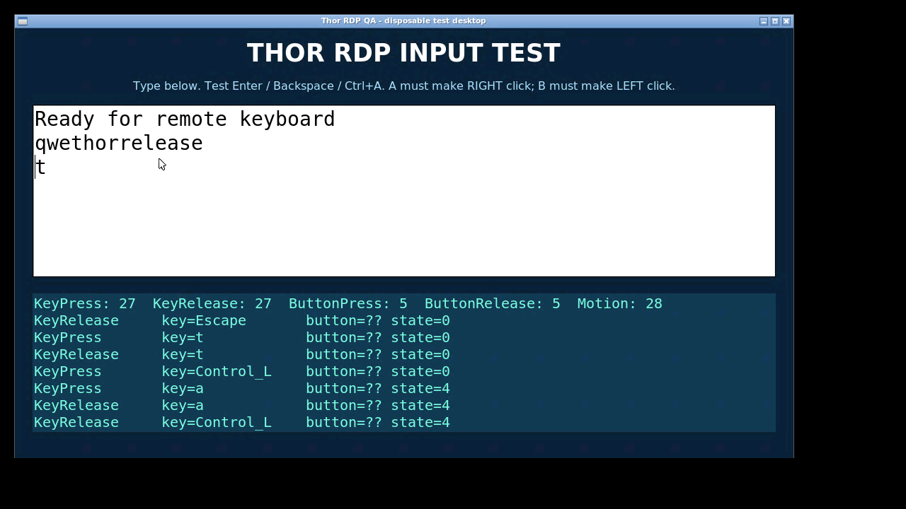

# Thor RDP

An experimental Android RDP client designed for the AYN Thor: remote desktop on
the upper screen, a PC keyboard or touchpad on the lower screen, and gamepad
controls for the mouse. Both screens send input to the same RDP session.

Built from [aRDP / remote-desktop-clients](https://github.com/iiordanov/remote-desktop-clients)
and FreeRDP. This is an independent app, not Microsoft Windows App, and is not
affiliated with Microsoft or AYN.

**0.1.1 is a preview.** This update fixes audio playback, local volume buttons,
and the lower keyboard's physical-key encoding for host input methods such as
EVKey. It also widens Space. Automated runtime testing uses an Android x86_64
emulator with two displays and a real xrdp server; Windows EVKey and the updated
ARM64 build still need confirmation on physical Thor hardware.

[Download v0.1.1](https://github.com/Dasionz/thor-rdp/releases/tag/v0.1.1)
· [Hướng dẫn tiếng Việt](docs/HUONG-DAN.md)
· [QA report (Vietnamese)](docs/KIEM-TRA-0.1.1.md)
· [Build instructions](THOR_BUILD.md)

## Install and connect

1. Download `thor-rdp-0.1.1-arm64.apk` from the release and install it on your Thor.
   Install over 0.1.0 to retain saved connections; the package and signing key are unchanged.
2. Open **Thor RDP** on the upper screen and add a manual connection.
3. Enter your PC's address, RDP port, username, password, and domain if needed.
4. Connect and check the server certificate before accepting it. The lower-screen
   keyboard appears when the remote session opens.

Your PC must already support and allow incoming RDP connections. Use your existing
VPN or remote-access network route when away from home. The app does not configure
Windows, your router, or a VPN, and it does not import saved Windows App accounts.
Windows Hello PINs generally are not RDP passwords. Windows Home does not include
an RDP host.

No root, Accessibility service, or Shizuku is needed for the custom controls.
The lower keyboard sends PC key events directly to the RDP session; it does not
open the Android keyboard or take keyboard focus from the upper desktop.
For Vietnamese Telex/VNI input, enable the corresponding input method on the PC.
With EVKey, select the English (US) keyboard layout in Windows and enable EVKey's
Vietnamese Telex mode. The lower keyboard now sends RDP scancodes; the Android
IME retains the existing Unicode input path.

Audio defaults to playback on the Android device. Upgrading from 0.1.0 changes
saved Disabled profiles to On Device once, because the old setup screen forced
audio off. You can subsequently choose On Device, On Server, or Disabled in the
connection's audio settings; that choice is retained.

## Controls

| Control | Action |
| --- | --- |
| Left stick | Move the pointer, with slower movement near the center |
| Right stick up/down | Scroll |
| Hardware volume up/down | Adjust the Thor's media volume |
| Android A | Hold/release the right mouse button |
| Android B | Hold/release the left mouse button; hold while moving to drag |
| A/B switch on the lower screen | Swap the mapping to match your firmware's button layout |
| Ctrl, Alt, Shift, Win | Toggle a held modifier; highlighted while held |
| Release keys | Release keys and mouse buttons held by the custom controls |
| Touchpad / Keyboard | Switch the lower-screen layout |
| Disconnect | End the RDP session |

Touchpad mode supports one-finger movement, tap for left-click, two-finger tap for
right-click, two-finger scrolling, and separate mouse buttons for dragging.
If a suitable second display is unavailable, the main screen's keyboard button
still provides the Android keyboard.

*0.1.1 lower-screen keyboard with wider Space in the Android emulator.*

*Disposable xrdp test desktop receiving keyboard and gamepad input. This is the
test server, not a screenshot of Microsoft Windows.*

## Verified and remaining work

The x86_64 release was tested for TLS certificate accept/reject, reconnect,
lower-screen key input without changing upper-screen focus, joystick movement,
A/B click down/up, modifiers, background/resume, and lower-display resizing.
The ARM64 APK was checked with `apksigner` and `zipalign`; its runtime is untested.
The 0.1.1 checks also verified an upgrade retaining saved profiles, real RDP audio
at the Android output, local volume without remote scrolling, physical deck key
events, and five input/audio migration instrumentation tests.

- Physical Thor uses two internal displays; the emulator used a virtual second
  display. Display behavior, physical button labels, and long sessions need
  confirmation on hardware.
- Windows authentication, NLA, Microsoft/Entra accounts, RD Gateway, EVKey,
  microphone, and device redirection have not been verified in our test setup.
- Windows 365, Azure Virtual Desktop, and Windows App brokered sign-in are outside
  the scope of this direct-PC RDP preview.
- The inherited prebuilt native stack is FreeRDP 2.11.7 and OpenSSL 1.1.1w. This
  release does not upgrade or security-audit that stack.
- ARM64 native libraries have 4 KiB ELF alignment. Android 16 KiB page-size
  compatibility has not been established.

Please include your Thor firmware, Android version, host OS, display behavior,
and reproducible steps in bug reports. Do not post passwords, private keys, or
private connection details.

## Source and build

See [THOR_BUILD.md](THOR_BUILD.md) for the Windows build and pinned dependency
downloads. The release includes a source archive with this application's changes,
build scripts, upstream native recipes, and patches. Native binary provenance and
rebuild limitations are described in the build notes and
[third-party notices](THIRD_PARTY_NOTICES.md).

- Application ID: `dev.thor.freerdp`
- Android version name: `0.1.1-thor`; version code: `2`
- GitHub release tag: `v0.1.1`
- Published APK ABI: `arm64-v8a`
- Manifest minSdk: 21; target SDK: 36. Runtime QA used Android 14 / API 34 only;
  compatibility with older Android versions is unverified.

Release checksums are in `SHA256SUMS.txt` on the release page. The signing
certificate's SHA-256 fingerprint is
`f8f6d0138ae97d22595fe3ec2c581f82b3ff1d8fa31a81fb8d4758ab25b1ee35`.
Private signing material is not part of the repository. Builds signed with a
different key cannot install as an update over the published APK.

## Credits and license

Based on iiordanov/remote-desktop-clients commit
[`fd308d8596d95e221b388ff0172d7533cb255f31`](https://github.com/iiordanov/remote-desktop-clients/tree/fd308d8596d95e221b388ff0172d7533cb255f31).
The original project includes bVNC, aRDP, aSPICE, and Opaque; this snapshot retains
their source tree and notices. The original README is preserved in
[docs/UPSTREAM-README.md](docs/UPSTREAM-README.md).

The application is distributed under the [GNU GPL v3](LICENSE), with upstream
copyright notices in [COPYRIGHT-bVNC](COPYRIGHT-bVNC) and individual source files.
Third-party components retain their respective licenses; see
[THIRD_PARTY_NOTICES.md](THIRD_PARTY_NOTICES.md) and `licenses/`.
