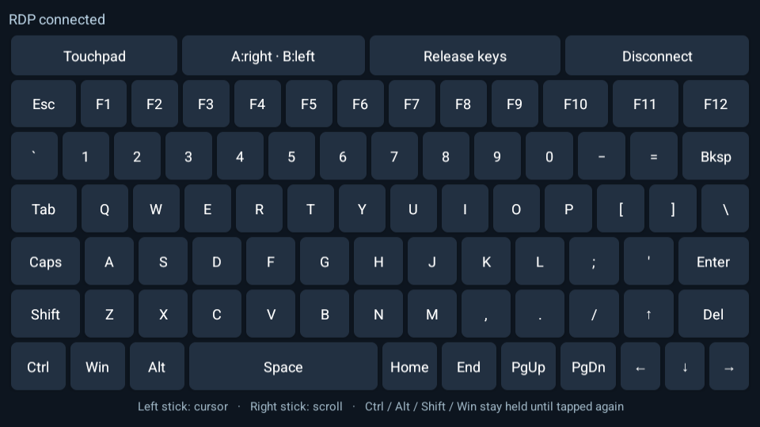
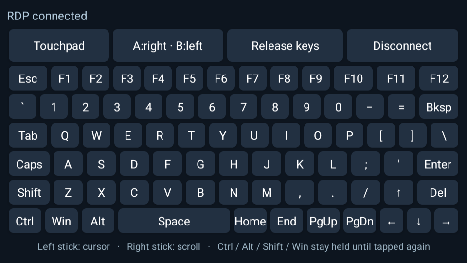

# Kiểm tra Thor RDP 0.1.1

Ngày kiểm tra: 2026-10-04. Phiên bản Android `0.1.1-thor`, version code `2`.

## Môi trường và phạm vi

- Android 14 / API 34, giả lập x86_64: màn trên 1280×720, màn dưới 960×544; kiểm tra ở 240 và 320 dpi.
- Máy chủ xrdp dùng riêng cho kiểm tra, có module PulseAudio xrdp. Không dùng máy Windows hay tài khoản thật của người dùng.
- APK x86_64 release cùng mã nguồn và khóa ký với APK ARM64 phát hành. APK ARM64 được kiểm tra chữ ký/căn chỉnh, chưa chạy trực tiếp trên Thor trong đợt QA này.
- Cài đè bản 0.1.0 có cấu hình và mật khẩu thử đã lưu, không xóa dữ liệu ứng dụng.

## Kết quả

| Hạng mục | Bằng chứng |
| --- | --- |
| Tái hiện lỗi cũ | Trên 0.1.0, nút âm lượng tạo Button4/5 cuộn ở máy chủ; cấu hình bị buộc Disabled và không có gói âm thanh ở đầu ra Android khi máy chủ phát âm thử. |
| Cài đè và dữ liệu cũ | 0.1.1 giữ cấu hình, địa chỉ và mật khẩu thử; âm thanh của cấu hình cũ đổi từ Disabled sang On Device. |
| Lựa chọn âm thanh về sau | Trong UI thật, chọn Disabled hoặc On Server rồi lưu/mở lại đều giữ đúng lựa chọn; sau kiểm tra đặt lại On Device. |
| Âm thanh qua RDP | Phát âm 997 Hz ở máy chủ; Android nhận 813 gói PCM, khoảng 8,72 giây. RMS 72,48 và peak 133 trên PCM 16 bit; cửa sổ 4096 mẫu có năng lượng cao nhất cho đỉnh phổ 997 Hz. Log native xác nhận RDPSND/OpenSL ES. Đây là xác nhận âm thanh thực sự tới đầu ra Android. |
| Nút âm lượng | Sau khi chạm bàn phím dưới, media volume đổi 5→6→5; không xuất hiện sự kiện chuột/phím ở máy chủ do hai nút này. |
| Joystick và A/B | Joystick phải vẫn tạo sự kiện cuộn; A tạo chuột phải, B tạo chuột trái, có cả nhấn và nhả. |
| Bàn phím dưới | Chuỗi `tieengs vieetj` đi qua phiên RDP thật với nhấn/nhả từng phím. Kiểm tra thêm Shift+A, dấu `!`, số, dấu chấm phẩy, Ctrl+A, Enter, Backspace và Release keys. |
| Mã phím cho bộ gõ | Test trên mapper của ứng dụng xác nhận các phím bàn phím dưới dùng virtual key; FreeRDP chuyển đường này thành RDP scancode. Android IME vẫn dùng Unicode, gồm ký tự tiếng Việt. |
| Focus và Space | Chạm màn dưới vẫn giữ RemoteCanvasActivity trên màn 0 làm cửa sổ có focus. Space rộng hơn; kiểm tra ảnh ở cả 240/320 dpi không thấy phím bị cắt hay chồng lên nhau. |
| Test tự động | 5/5 Android instrumentation tests đạt, gồm 2 test input và 3 test cơ sở dữ liệu SQLCipher. Thời gian lượt cuối 0,585 giây. |
| Build và đóng gói | Release build và test APK build thành công; `git diff --check`, `apksigner verify`, `zipalign -c` đạt. |

Các test cơ sở dữ liệu dùng tệp tạm riêng: sửa Disabled một lần khi nâng từ 641 lên 642, giữ On Server/On Device, giữ lựa chọn tắt tiếng về sau và không đổi hành vi các flavor upstream khác. Test input còn kiểm tra nút âm lượng trước/sau khi kết nối, nhấn giữ/lặp và nhả phím.

Chạy suite bằng hai tên lớp cụ thể theo [THOR_BUILD.md](../THOR_BUILD.md). Đợt chuẩn bị test đã sửa dependency biên dịch và dữ liệu mô phỏng trục joystick; không thay đổi cách joystick hoạt động trong ứng dụng để làm test đạt.

## Giới hạn còn lại

- Chưa test trực tiếp EVKey trên Windows. Đã xác nhận thay đổi đường gửi phím và input qua RDP thật; chưa thể khẳng định mọi ứng dụng Windows/bản EVKey đều gõ tiếng Việt đúng.
- Chưa xác nhận bản ARM64 mới trên AYN Thor vật lý, loa/Bluetooth của Thor, khác biệt firmware hoặc độ ổn định trong phiên dài.
- Máy chủ kiểm tra là xrdp; không thay thế kiểm tra Windows/NLA, Microsoft/Entra, RD Gateway, microphone hay chuyển hướng thiết bị.
- Native FreeRDP 2.11.7/OpenSSL 1.1.1w giữ nguyên; đợt này không nâng cấp hay kiểm toán bảo mật backend. Tương thích trang nhớ Android 16 KiB chưa được thiết lập.

## Nhận diện APK

- ARM64 SHA-256: `ac6f1a64e7176ffc31958b248c658a9e26c9ea46c33a0f933f91255c8bc6cf65`.
- APK x86_64 dùng QA: `c99cffe54c30ee9d3df5c1bcaaa54c21a0bb8907aa695a6e9df65709f46c4ec2`.
- Chứng chỉ ký giữ nguyên từ 0.1.0: `f8f6d0138ae97d22595fe3ec2c581f82b3ff1d8fa31a81fb8d4758ab25b1ee35`.

Xem thêm [hướng dẫn sử dụng](HUONG-DAN.md) và [báo cáo lịch sử 0.1.0](KIEM-TRA.md).
